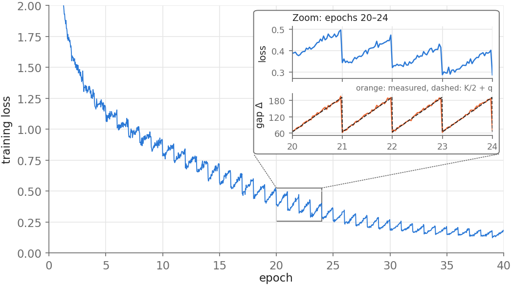
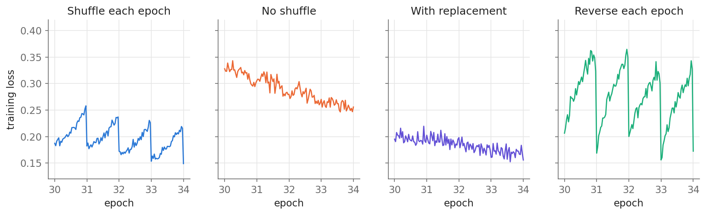

# Why Training Loss Sawtooths Across Epochs

*The expected gap since a sample was last trained on follows a sawtooth.*

Code for the blog post [Why Training Loss Sawtooths Across Epochs](https://liqq010.github.io/posts/epochal-sawtooth/).



*Training loss of a small GPT over 40 epochs, shuffled every epoch. Inset: epochs 20–24, with the mean gap Δ of the same batches below, measured and predicted (K/2 + q); it rises and resets with the loss.*

When a model is trained for many epochs with per-epoch shuffling, the training loss often creeps up within each epoch and drops at every epoch boundary (the *Epochal Sawtooth Phenomenon*, [Liu & Ma, 2025](https://arxiv.org/abs/2410.10056)). The post explains it with one quantity: the gap $\Delta$ since a sample was last trained on. Under shuffling, $\mathbb{E}[\Delta \mid q] \approx K/2 + q$ at step $q$ of an epoch with $K$ steps, so if a sample's loss grows with $\Delta$, the logged loss follows a sawtooth. The same argument predicts the effect of every sampling scheme, which this repo tests on a small GPT.



| Sampling | Gap $\Delta$ at step $q$ | Loss change within an epoch |
|---|---|---|
| Shuffle every epoch | uniform on $[q+1, q+K]$ | **+32%** |
| No shuffle | $K$ | −6% |
| With replacement | geometric, mean $K$ | −4% |
| Reverse every epoch | $1 + 2q$ | **+64%** |

## Reproduce

```bash
pip install -r requirements.txt
./download_data.sh          # TinyStories validation split (21 MB); only the first ~0.5 MB is used
NGPU=8 ./run_all.sh         # 39 runs, about 2 minutes each; set NGPU to the number of GPUs
python plot.py              # all figures of the post -> figs/
python stats.py             # the numbers quoted in the post
```

With one GPU, `./run_all.sh` still launches all 39 runs in parallel on it (about 1 GB of memory each).

## Setup

- **Data:** the first 4,096 × 129 bytes of `TinyStoriesV2-GPT4-valid.txt`, cut into 4,096 sequences of 128 bytes.
- **Model:** byte-level GPT, 4 layers, width 256 (3.3M parameters); widths 128 and 512 for the capacity comparison.
- **Batch size comparison:** batch sizes 16, 64 and 128 with shuffling (32 is the main runs), everything else unchanged.
- **$\beta_2$ comparison:** $\beta_2$ = 0.95, 0.9, 0.8 and 0.7 with shuffling (0.999 is the main runs), everything else unchanged.
- **Training:** batch size 32 (so $K = 128$ steps per epoch), 40 epochs, AdamW with lr $10^{-3}$, $\beta = (0.9, 0.999)$, no weight decay, no dropout, bf16 autocast. Seeds 0, 1, 2.
- **Logged at every step:** the batch loss before the update, and for each sample in the batch its loss and its gap $\Delta$. Every 8 steps: the loss on a fixed set of 512 training samples.

## Files

| File | What it does |
|---|---|
| `train.py` | One training run (`--mode shuffle / noshuffle / replace / reverse`, `--d` width, `--bs` batch size, `--beta2`, `--seed`); saves per-step and per-sample logs to an `.npz` |
| `run_all.sh` | All 39 runs used in the post |
| `plot.py` | Figures of the post |
| `stats.py` | Numbers quoted in the post |
| `download_data.sh` | Downloads the data |

## Citation

If you find this work useful, please cite the blog post:

> Li, Quanquan. "Why Training Loss Sawtooths Across Epochs." *Quanquan Li's blog*, October 15, 2026. https://liqq010.github.io/posts/epochal-sawtooth/

```bibtex
@misc{li2026epochalsawtooth,
  author       = {Li, Quanquan},
  title        = {Why Training Loss Sawtooths Across Epochs},
  year         = {2026},
  month        = {October},
  day          = {15},
  howpublished = {\url{https://liqq010.github.io/posts/epochal-sawtooth/}},
  note         = {Blog post}
}
```
